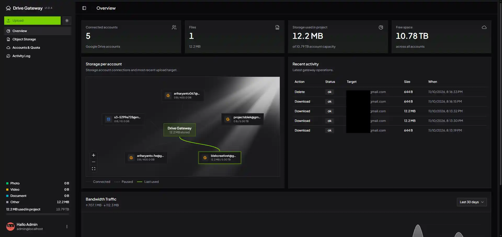
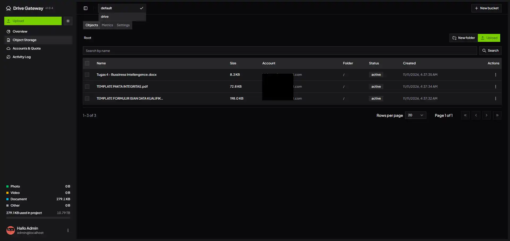
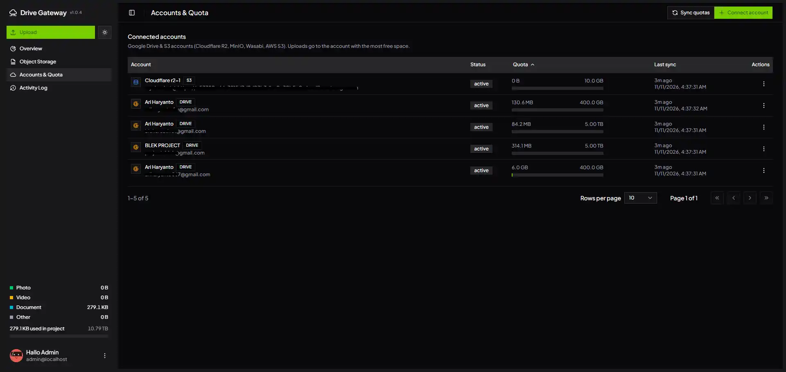
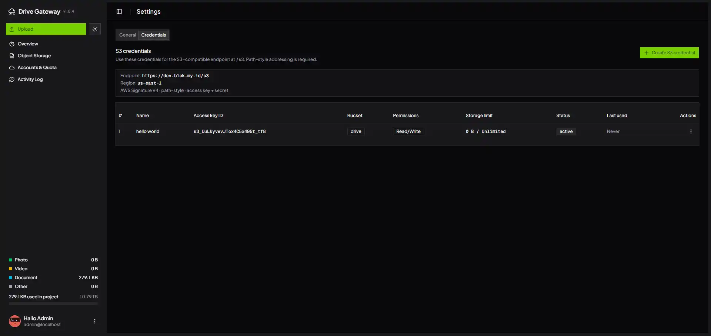

# Drive Gateway

A multi-provider **storage gateway** (Google Drive & S3 backends) with an admin dashboard and an S3-compatible REST API.

Uploads are routed automatically to the connected storage account with the **most free space** (ties go to the least recently used account), or round-robin if configured.

## Screenshots

| Overview | Object Storage |
| --- | --- |
|  |  |

| Accounts & Quota | S3 Credentials |
| --- | --- |
|  |  |

## Features

- Connect multiple **Google Drive** accounts via OAuth 2.0.
- Connect external **S3 storage backends** (Cloudflare R2, MinIO, Wasabi, Backblaze B2, AWS S3) with customizable quota limits.
- Automatic account selection across all providers based on remaining quota (`quota` or `round_robin`).
- S3-compatible API endpoint (`/s3`) with AWS Signature V4 authentication, bucket isolation, and storage limits.
- WebDAV endpoint (`/webdav`) with RFC 4918 support for Windows Explorer network drive mapping, macOS Finder, Cyberduck, and Rclone.
- Admin dashboard: overview with bandwidth charts, accounts & quota, file manager with bucket selector, S3 credentials, activity log.
- File manager: folders, breadcrumb navigation, search, pagination, checkbox bulk actions (files and folders), rename, move, and permanent delete.
- Upload dialog with drag & drop, multiple files, per-file progress, bucket selection, and folder destination.
- Server-side upload limit from `MAX_UPLOAD_BYTES`; the limit is shown in the UI.
- Deletes remove files and folders immediately from their storage provider; there is no application recycle bin. Existing trashed Google Drive records from earlier versions remain visible only in provider storage and are not automatically purged during upgrade.
- Sidebar storage breakdown: photos, videos, documents, free space, and used space.
- Sonner toasts, confirmation dialogs, and responsive header actions (icon-only on mobile).
- SQLite + Drizzle ORM, Docker support with a persistent volume.
- Secrets and refresh tokens encrypted with AES-256-GCM; S3 credentials stored securely.

## Stack

Next.js 16 (App Router) · React 19 · TypeScript · Tailwind CSS v4 · shadcn/ui · Drizzle ORM + SQLite · googleapis · Sonner

## Requirements

- Node.js 20+ (Docker uses Node 24)
- pnpm 12.9.1 (`corepack enable`)
- A Google Cloud project with Google Drive API and an OAuth 2.0 Web Client
- Docker + Docker Compose (optional)

## Quick Start

```bash
pnpm install
cp .env.example .env
# fill in the environment variables
pnpm db:migrate
pnpm dev
```

Open:

- `http://localhost:3000/login` — admin login
- `http://localhost:3000/dashboard` — admin dashboard

There is no signup page. Admin credentials come only from `ADMIN_EMAIL` and `ADMIN_PASSWORD`.

## Google OAuth Setup

1. Create a project in [Google Cloud Console](https://console.cloud.google.com/).
2. Enable **Google Drive API**.
3. Configure the OAuth consent screen. While the app is in **Testing**, add every Google account you want to use as a **Test user**.
4. Create an **OAuth 2.0 Client ID** of type **Web application**.
5. Add the exact redirect URI:
   - `http://localhost:3000/api/auth/google/callback`
   - `https://your-domain/api/auth/google/callback`

Scopes:

```text
openid
email
profile
https://www.googleapis.com/auth/drive.file
```

`drive.file` is a non-sensitive scope: it only grants access to files created by the gateway, and it does not trigger Google's restricted-scope review. It is also enough to read `storageQuota` for quota syncing. For full Drive access, replace it with `https://www.googleapis.com/auth/drive` — note that this is a restricted scope and requires Google verification (and a security assessment for public apps).

## Environment

Configuration variables are documented in [`.env.example`](./.env.example). Copy it to `.env` and adjust the values:

```bash
cp .env.example .env
```

Generate `ENCRYPTION_KEY`:

```bash
node -e "console.log(require('crypto').randomBytes(32).toString('base64'))"
```

Never commit `.env`, `data/`, or `*.db`; they are gitignored.

## Running

### Development

```bash
pnpm dev
```

### Production (without Docker)

```bash
pnpm build
pnpm start
```

Set `APP_URL` and `GOOGLE_REDIRECT_URI` to the production domain and use HTTPS.

### Docker

```bash
docker compose up -d --build
docker compose logs -f gateway
```

- Port: `3000`
- Volume: `drive_gateway_data` mounted at `/data`
- Database migrations run automatically on container start. The container fixes `/data` ownership before migrations, then runs the app as the unprivileged `gateway` user.
- `docker compose down` keeps the volume. Do **not** use `docker compose down -v` unless you want to delete the data.

## Usage

> **Permanent deletion:** This app has no recycle bin. Delete operations remove objects from the backing provider immediately and cannot be undone. Google Drive may retain its own provider-side recovery window; S3/R2 behavior follows that provider's configuration.

1. Log in at `/login`.
2. Go to `/dashboard/accounts` and click **Connect account**. Repeat for each Google account.
3. Upload from `/dashboard/object-storage` or the sidebar. Files are routed by available quota.
4. Manage folders and files with checkboxes, bulk actions, or the 3-dot row menu.
5. Deleting a file or folder removes it permanently from the storage provider; verify before confirming because it cannot be restored from this app.
## S3-Compatible API

Drive Gateway provides an S3-compatible API at `/s3`. It supports standard AWS Signature V4 authentication using access key ID and secret access key.

### Configuration for S3 Clients

- **Endpoint:** `http://<host>:3000/s3` (or `https://your-domain/s3`)
- **Region:** `us-east-1` (or whatever `S3_REGION` is set to)
- **Path-style:** Required (`force_path_style = true`)
- **Credentials:** Create at `/dashboard/settings` under **S3 credentials**.

### Credential Isolation & Quota

When creating S3 credentials in the dashboard, you can configure:
- **Bucket Scope:** Each credential is restricted to one selected bucket (e.g. `blog`). It cannot see or access other buckets (`ListBuckets` only returns its assigned bucket; requests to other buckets return `403 AccessDenied`).
- **Permissions:** Choose `Read & Write` or `Read Only`. Read-only credentials reject `PUT` and `DELETE` requests with `403 AccessDenied`.
- **Storage Limit:** Set a maximum storage capacity (e.g. `10 GB` or `500 MB`). Uploads exceeding the limit are blocked with `403 QuotaExceeded`. The dashboard shows live usage against the quota (`Used / Max`).

### Supported S3 Operations

- `ListBuckets`
- `HeadBucket`
- `CreateBucket`
- `DeleteBucket` (empty buckets only)
- `GetBucketLocation`
- `ListObjectsV2` (prefix, delimiter, continuation token)
- `PutObject` (single request up to `S3_MAX_PUT_BYTES`, ETag MD5, metadata)
- `GetObject` (streaming, Range requests)
- `HeadObject` (metadata, ETag, Content-Type)
- `DeleteObject` (permanently deletes the object from the backing storage)

### S3 Client Examples

#### rclone

Configure `~/.config/rclone/rclone.conf`:

```ini
[drive-gw]
type = s3
provider = Other
endpoint = https://your-domain/s3
access_key_id = s3_your_access_key
secret_access_key = your_secret_key
region = us-east-1
force_path_style = true
```

Commands:

```bash
rclone lsd drive-gw:
rclone copy ./my-file.zip drive-gw:default/backups/
rclone ls drive-gw:default/backups/
```

#### AWS CLI

```bash
export AWS_ACCESS_KEY_ID="s3_your_access_key"
export AWS_SECRET_ACCESS_KEY="your_secret_key"
export AWS_DEFAULT_REGION="us-east-1"
ENDPOINT="http://localhost:3000/s3"

# List buckets
aws --endpoint-url $ENDPOINT s3api list-buckets

# Upload an object
aws --endpoint-url $ENDPOINT s3api put-object \
  --bucket default --key photos/sunset.jpg --body ./sunset.jpg

# List objects with prefix
aws --endpoint-url $ENDPOINT s3api list-objects-v2 \
  --bucket default --prefix photos/

# Download object
aws --endpoint-url $ENDPOINT s3api get-object \
  --bucket default --key photos/sunset.jpg ./downloaded.jpg

# Delete object
aws --endpoint-url $ENDPOINT s3api delete-object \
  --bucket default --key photos/sunset.jpg
```

### WebDAV

Connect to `https://your-domain/webdav` in production (or `http://localhost:3000/webdav` locally).

Supports HTTP Basic Authentication with:
- **Admin credentials**: `ADMIN_EMAIL` as username and `ADMIN_PASSWORD` as password.
- **S3 credentials**: `accessKeyId` (`s3_...`) as username and `secretAccessKey` as password (supports bucket-level isolation and read-only permissions).

#### Client Setup Examples
- **Windows File Explorer**:
  - Right-click *This PC* → *Map network drive...*
  - Folder: `https://your-domain/webdav` (or `http://localhost:3000/webdav`)
  - *Note for plain HTTP*: Windows requires HTTPS for Basic Auth by default. To allow plain HTTP on LAN/localhost, set registry `HKLM\SYSTEM\CurrentControlSet\Services\WebClient\Parameters\BasicAuthLevel` to `2`.
- **Windows PowerShell (`net use`)**:
  ```powershell
  # Map drive
  net use Z: "https://your-domain/webdav" /user:admin@localhost changeme

  # Disconnect drive
  net use Z: /delete /y
  ```
- **macOS Finder**:
  - *Finder* → *Go* → *Connect to Server...* (`Cmd + K`)
  - Server Address: `https://your-domain/webdav` (or `http://localhost:3000/webdav` locally)
- **Rclone**:
  ```ini
  [drive-gateway-dav]
  type = webdav
  url = https://your-domain/webdav
  vendor = other
  user = admin@example.com
  pass = ...
  ```
- **Web Browser**: Visit `https://your-domain/webdav` directly to browse buckets and folders (locally: `http://localhost:3000/webdav`).

## Notes & Limitations

- **Folders are virtual** — stored as SQLite metadata, not physical folders in Google Drive.
- **Single admin** — no multi-user accounts or roles.
- **SQLite** — suitable for personal/small deployments; not horizontally scalable.
- **Single-request upload** — no chunked or resumable upload.
- **Cloudflare** — uploads are still capped at 100 MB per request on Free/Pro plans. `MAX_UPLOAD_BYTES` cannot bypass Cloudflare; use a DNS-only hostname or LAN access for larger files.
- **OAuth publishing** — while the consent screen is in **Testing**, only test users can connect and refresh tokens expire after 7 days. Publish the app to **Production** for any account to connect and for long-lived tokens; because the gateway only requests the non-sensitive `drive.file` scope, no restricted-scope review is required.
- **Quota totals** include Gmail and Photos, so the gateway file breakdown can be smaller than the account's used space.
- **Disconnect is soft** — tokens are removed, but indexed files remain in Google Drive.

## Security

- `/dashboard` and `/api/admin/*` require the admin session; `/docs` and `/api/openapi.json` are protected too.
- S3 credentials are bucket-scoped. An empty bucket is rejected; wildcard access requires an explicit opt-in.
- `ADMIN_PASSWORD` is compared in constant time; set a strong password and keep it only in the deployment environment.
- Login, backup, and restore attempts are rate limited per IP and persisted in SQLite. Successful checks clear the counter.
- Logging out bumps a session epoch, revoking every outstanding session token (including stolen cookies).
- Responses include `nosniff`, framing protection, a restrictive CSP, and a global `Content-Security-Policy` for the app. S3 objects are served with a sandbox CSP and safe `Content-Disposition`; only safe MIME types render inline.
- CORS is not enabled for the removed public REST API; cookie-authenticated admin routes do not allow cross-origin access.
- S3 backend endpoints are checked against SSRF: loopback, link-local, metadata hosts, and private ranges are blocked unless `S3_ALLOW_PRIVATE_ENDPOINTS=1`.
- S3 uploads must sign a payload hash; `UNSIGNED-PAYLOAD` is rejected for write operations.
- Refresh tokens and S3 secrets are encrypted with AES-256-GCM.
- `MAX_UPLOAD_BYTES` is enforced on the server before the body is processed.
- Changing `ENCRYPTION_KEY` invalidates existing sessions and stored refresh tokens.
- Use HTTPS in production and bind the container to loopback behind a TLS reverse proxy.

## Project Structure

```text
app/api/            auth, public v1, admin, and upload routes
app/dashboard/      admin pages (overview, accounts, files, activity, settings)
components/gateway/ admin UI components
components/ui/      shadcn/ui components
lib/db/             Drizzle schema, connection, migrations
lib/files/          file services (upload, list, delete, storage summary)
lib/folders/        virtual folder services
lib/google/         OAuth, Drive client, quota, account selection
data/               SQLite database and temp uploads (gitignored)
proxy.ts            Next.js 16 auth/redirect middleware
scripts/migrate.mjs automatic migrations for Docker
```

## Scripts

```bash
pnpm dev           # development
pnpm build         # production build
pnpm start         # run production build
pnpm lint          # ESLint
pnpm db:migrate    # apply migrations
pnpm db:generate   # generate a migration after schema changes
pnpm db:studio     # Drizzle Studio
```
